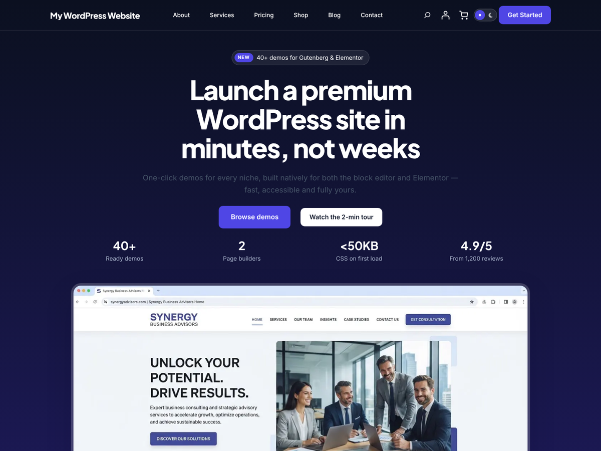

# Hi WPEssential

**A fast, multi-niche WordPress block theme, native for both Gutenberg and Elementor.**

Pick a demo, import it in one click with your favourite builder, and get a complete,
production-ready site: real pages, real content, real images, a working shop, light and dark
schemes, hover effects and SEO, all set up for you.

[Website](https://wpessential.org) · [Demos](https://wpessential.org/demos/) · [Download](../../releases/latest)

---

## Why Hi WPEssential

- **Two builders, one design.** Every demo ships in a **Gutenberg** version (core blocks only) and an **Elementor** version (native widgets and Kit globals, with no HTML widgets or custom CSS). Choose the builder you like; the look stays the same.
- **One-click demos.** The bundled WPEssential Core plugin installs the required plugins, imports the pages, posts, products, menus, images, header and footer, and applies the demo's style. You can remove a demo again with one click.
- **Try before you import.** Live demos run in your browser through WordPress Playground. You can click, hover and browse every page without installing anything.
- **Lightweight.** It is a block theme driven by theme.json with local fonts and no jQuery. Animation scripts load only when you turn them on.
- **Made for every screen.** Layouts are tuned at 1920, 1440, 1280, 1024, 768, 560, 480, 360 and 320 px. Below 1024 px the header becomes a compact bar with an off-canvas menu.

## Features

| | |
|---|---|
| 🎨 **Design system** | theme.json v2 tokens for colour, type, spacing, radius and shadows, plus a style variation per demo. |
| 🌗 **Light & dark** | A visitor toggle in the header. It follows the device setting on the first visit and remembers the choice. |
| ✨ **Hover & motion** | Hover effects for each niche, based on market research: zoom, lift, glow, underline and image swap. Animation presets are subtle, editorial, playful and dynamic (GSAP). |
| 🛒 **WooCommerce** | Styled shop, product, cart, checkout and account pages, plus product badges, a second-image hover, empty states and notices. |
| 🔍 **SEO** | Meta description, Open Graph, Twitter cards and JSON-LD (Organization, WebSite, Breadcrumbs, Article). It steps aside automatically for Yoast, Rank Math, SEOPress, AIOSEO and The SEO Framework. |
| 🌍 **Multilingual** | Translated into 20 languages (Arabic, Bengali, Chinese, Dutch, French, German, Hebrew, Hindi, Indonesian, Italian, Japanese, Korean, Persian, Polish, Portuguese, Russian, Spanish, Turkish, Urdu, Vietnamese). WPML and Polylang compatible. It includes a language switcher, a `wpml-config.xml` and full **RTL** support (Arabic, Urdu, Hebrew, Persian). |
| ♿ **Accessible** | WCAG 2.2 AA colour contrast, a skip link, visible focus states and reduced-motion support. |
| 🧩 **Patterns** | Full-page layouts (About, Services, Pricing, Contact, FAQ), shop rows and sections ready to insert. |
| 🛠 **Theme options** | A CSS and JavaScript snippet manager with device scopes and safe mode, and animation settings. |
| 🔑 **Pro** | License activation, plan upgrades and Pro demos from your WPEssential account, right inside the dashboard. |

## Demos

| Demo | Niche | Includes | Plan |
|---|---|---|---|
| **Base** | Business · Agency · Shop · Blog | 7 pages, 3 articles, 8 products | Free |
| **Maison** | Fashion store | Lookbook, atelier, journal, shop | Pro |
| **Pulse** | Events & conferences | Speakers, agenda, tickets, venue, sponsors | Pro |
| **Essential** | Themes & digital products | Demos, pricing plans, services, docs (the WPEssential.org site) | Pro |

Every demo is available for **Gutenberg** and **Elementor**. New demos are added regularly.

## Requirements

- WordPress 6.5 or newer
- PHP 7.4 or newer
- Optional: Elementor, WooCommerce, The Events Calendar, WPML or Polylang (each demo lists what it needs and installs it for you)

## Installation

1. Download `hi-wpessential.zip` from the [latest release](../../releases/latest).
2. In WordPress, go to **Appearance → Themes → Add New → Upload Theme**, choose the zip and click **Activate**.
3. Open **WPEssential → Demo Library**. Preview a demo, choose **Gutenberg** or **Elementor** and click **Import**.

That's it: your site is ready to edit.

## Frequently asked questions

**Do I need the WPEssential Core plugin?**
No. The theme works on its own. Core comes bundled and adds demo import, live preview, plugin setup and Pro licensing.

**Can I switch from Gutenberg to Elementor later?**
Yes. Remove the demo from the Demo Library and import the same demo with the other builder.

**Will importing a demo overwrite my content?**
No. The importer adds new content and keeps a record, so **Remove demo** deletes only what it added and restores your previous style, header and footer.

**Is it translation ready?**
Yes. All strings use the `wpessential` text domain, and the theme works with WPML, Polylang and right-to-left languages.

**How do I turn off the light/dark toggle?**
Add `add_filter( 'wpessential_scheme_toggle', '__return_false' );` to a snippet or child theme.

## Support

Questions, bugs or ideas? Visit [wpessential.org](https://wpessential.org) or open an issue in this repository.

## License

Hi WPEssential is free software released under the [GNU GPL v2 or later](LICENSE).
Fonts, icons and images are credited in [readme.txt](readme.txt).

© 2026 WPEssential Team
