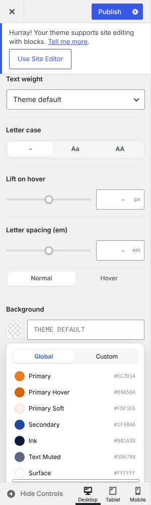
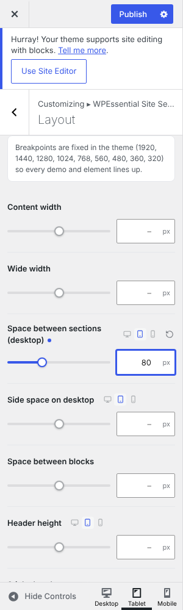
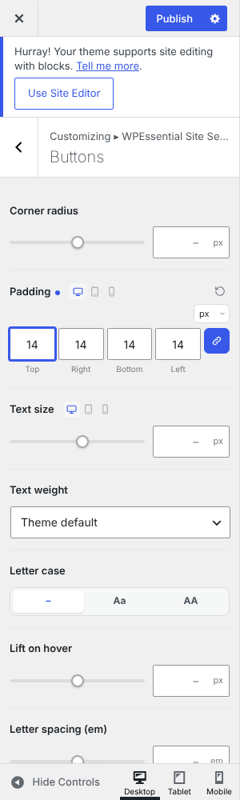
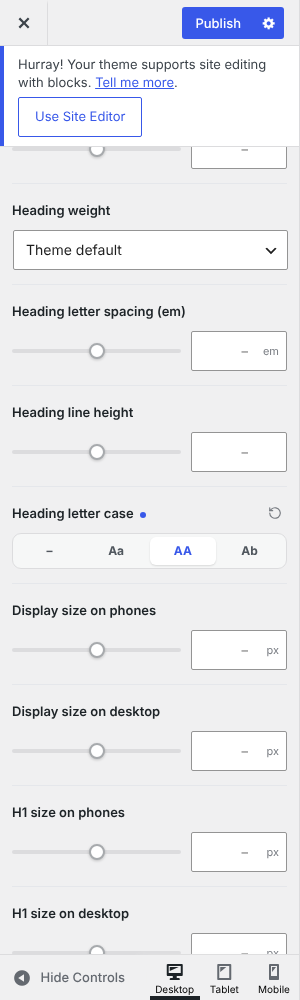
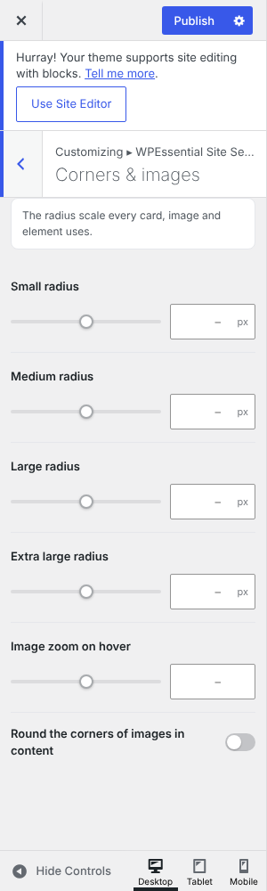
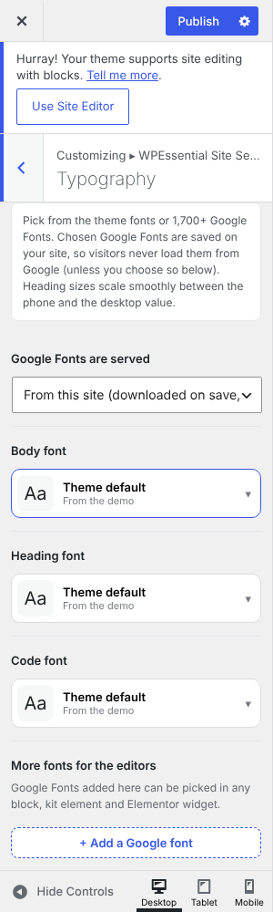
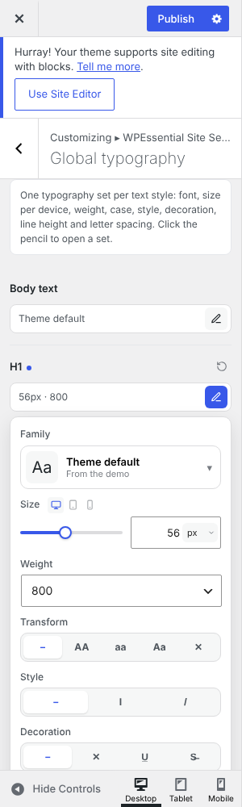
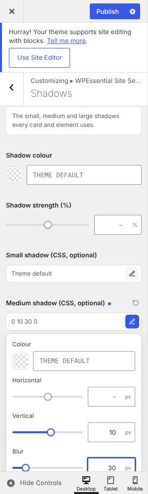
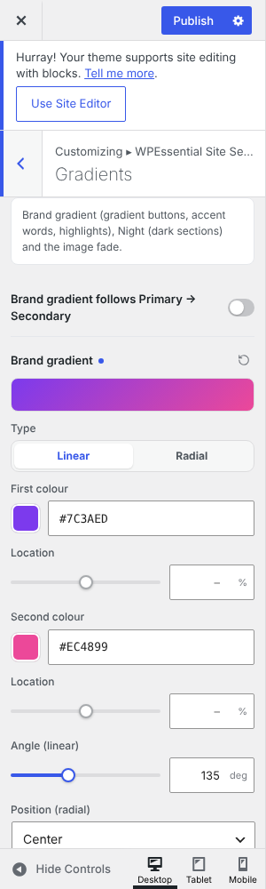
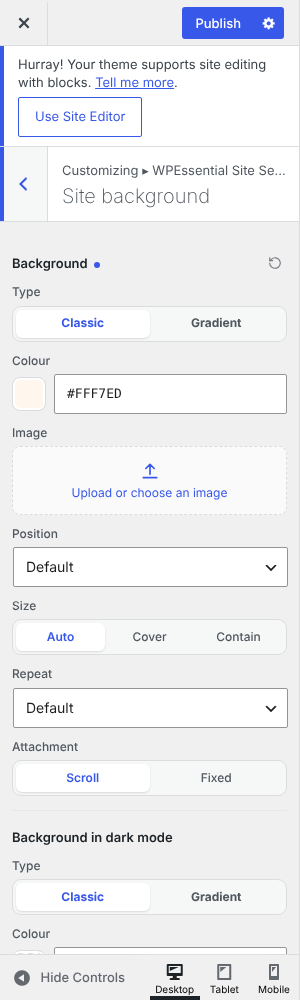

# Controls

The theme has its own form controls, modelled on Elementor's controls. They power **Appearance → Site Settings** and can be reused in any settings screen.

- **Code:** `assets/js/wpe-controls.js` (UI, no build step), `assets/css/customizer-controls.css` (styles), `inc/class-wpessential-customize-control.php` (Customizer control), `inc/customizer-fields.php` (CSS output).
- **Values** are strings. Composite and responsive controls store JSON, so one setting holds the whole value.
- **Every control** shows a blue dot when it is changed and has a reset button that goes back to the theme default (an empty value).

## Using a control

### In the Site Settings (PHP)

Add a field to a section in `wpessential_site_fields_base()` or `wpessential_site_fields_upgrade()`:

```php
'my_space' => array(
	'type'       => 'range',      // Any type below.
	'label'      => __( 'Space', 'hi-wpessential' ),
	'min'        => 0,
	'max'        => 200,
	'unit'       => 'px',
	'responsive' => true,         // Desktop / tablet / mobile values.
),
```

The field gets a setting `wpessential_site[my_space]` and the matching control automatically.

To turn the value into CSS, add the key to `wpessential_site_targets()`:

```php
'my_space' => array( '.my-section', 'padding-block' ),
```

Responsive values are written for desktop, tablet (`max-width: 1023px`) and mobile (`max-width: 767px`).

### Anywhere else (JavaScript)

Load `wpe-controls.js` and build a control from a type and a small context:

```js
var ctl = wpeControls.create( 'typography', {
	label: 'Heading',
	opt: {},
	get: function () { return myValue; },          // String (JSON for composite controls).
	set: function ( v ) { myValue = v; save( v ); },
} );
container.appendChild( ctl.el );
ctl.refresh();                                     // Call after the value changes elsewhere.
if ( ctl.devices ) { label.appendChild( ctl.devices ); } // Responsive controls only.
```

`wpeControls.setDevice( 'tablet' )` switches every responsive control. `wpeControls.onDevice` is called when a device button is clicked; in the Customizer it switches the preview device.

## Control types

### Colour (`color`)



A popover with two tabs:

- **Global:** the site palette.
- **Custom:** any colour, with opacity.

There is also a field where you can type a hex, `rgb()`, `hsl()` or `var()` value.

Value: `#7c3aed`, or 8-digit hex with opacity.

### Slider (`range`) and responsive slider



A slider and a number box with its unit. Give the field `'units' => array( 'px', 'em', 'rem', '%', 'vw' )` to get a unit select.

With `'responsive' => true` the label shows Elementor's device buttons; each device keeps its own value.

| Setting | Value |
| --- | --- |
| Plain | `24` |
| Other unit | `{"size":2,"unit":"em"}` |
| Responsive | `{"desktop":"120","tablet":"80","mobile":"56"}` |

### Dimensions (`dimensions`)



Top, right, bottom and left, with a link button that keeps all four the same and a unit select. Usually responsive.

Value: `{"desktop":{"top":14,"right":24,"bottom":14,"left":24,"unit":"px"}}`.

### Choose (`choose`) and button group (`buttons`)



Icon or text buttons for a few choices, like Elementor's CHOOSE control.

Choices are `value => label`, or `value => array( label, icon )` for icon buttons. A `select` field with up to three short choices is shown as a button group automatically.

### Switch (`toggle`)



On/off. Value: `1` or empty.

### Select (`select`) and text (`text`)

A styled dropdown and a text field.

### Font (`font`) and font list (`fonts`)



A font picker with:

- search
- categories (in theme, sans, serif, display, handwriting, mono)
- every font shown in its own face

It lists the theme's bundled fonts and 1,700+ Google Fonts.

| Type | Value |
| --- | --- |
| `font` | `Inter` (bundled) or `google:Poppins` |
| `fonts` | several Google families as `Lora|Poppins` |

See [Google Fonts](Google-Fonts).

### Typography (`typography`)



Elementor's typography popover. The bar shows a summary; the pencil opens the group:

- family
- size per device, with units
- weight
- transform
- style
- decoration
- line height and letter spacing, per device

Value: `{"family":"google:Poppins","size":{"desktop":"56","mobile":"34"},"weight":"800"}`.

### Box shadow (`shadow`)



Colour, horizontal, vertical, blur, spread and outline / inset, in a popover.

Value: `{"x":0,"y":10,"blur":30,"spread":0,"color":"#0000001f"}`.

### Gradient (`gradient`)



A live preview bar, plus:

- type (linear / radial)
- two colours, each with its location
- angle (linear) and position (radial)

Value: `{"from":"#7c3aed","to":"#ec4899","angle":135}`.

### Background (`background`)



Two modes:

- **Classic:** colour and image, with position, size, repeat and attachment.
- **Gradient:** a gradient control.

Value: `{"type":"gradient","gradient":{…}}` or `{"color":"#fff7ed","image":{"id":12,"url":"…"},"size":"cover"}`.

### Media (`media`)

Upload or pick an image from the Media Library, with Replace and Remove.

Value: `{"id":12,"url":"https://…"}`.

### Normal / Hover tabs

Add `'tab' => 'normal'` or `'tab' => 'hover'` to fields in the same section. The section shows a Normal / Hover switch and one set at a time, like Elementor's state tabs.

### Heading (`heading`)

A label that splits a long section into groups, for example "Header" and "Footer". It stores nothing.
